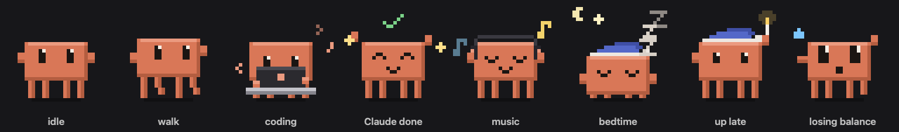
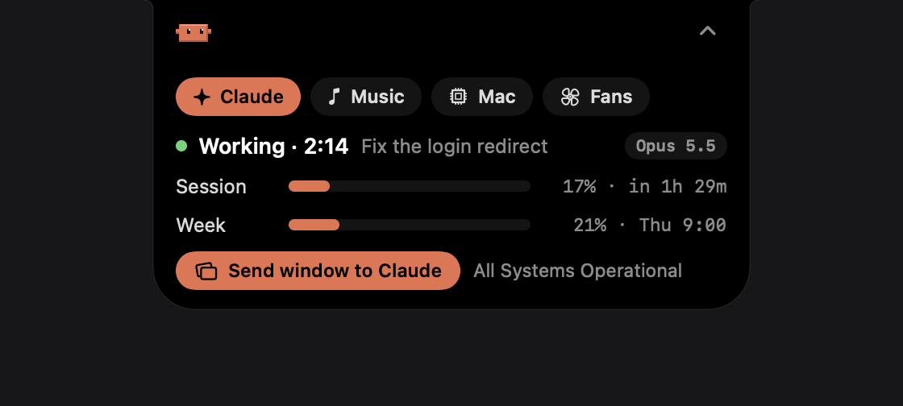

<p align="center">
  
</p>

<h1 align="center">Bitsy</h1>

<p align="center">A tiny pixel pet that lives on your Mac and keeps an eye on Claude Code for you.</p>

<p align="center">
  <a href="https://github.com/boyangeorgiev25/bitsy/releases/latest/download/Bitsy.dmg"></a>
</p>

<p align="center">
  
</p>

- Walks on your Dock and jumps between your windows. Drag a window and it falls off.
- Codes along while Claude Code works and cheers with **Done!** when it finishes.
- Drop it on the notch and it becomes a **Dynamic Island** with your music and Claude status.
- Double-click it to send a screenshot of your window to Claude.
- Headphones when music plays, a nightcap at bedtime, and fan control when your Mac gets hot.

<p align="center">
  
</p>

## Install

1. [Download **Bitsy.dmg**](https://github.com/boyangeorgiev25/bitsy/releases/latest/download/Bitsy.dmg), open it, and drag **Bitsy** into **Applications**.
2. Open Bitsy. macOS says it can't verify the app: click **Done**.
3. Go to **System Settings → Privacy & Security**, scroll down, and click **Open Anyway** next to Bitsy.

You only do step 3 once. Bitsy then lives in your menu bar. Needs macOS 13+, Apple Silicon or Intel.

**Build it yourself** (needs Xcode):

```bash
git clone https://github.com/boyangeorgiev25/bitsy.git
cd bitsy/bitsy-mac && ./build.sh
cp -R build/Bitsy.app /Applications/ && open /Applications/Bitsy.app
```

For Claude usage numbers, permissions, fan control and more, see the [guide](docs/GUIDE.md).

---

<sub>Not affiliated with Anthropic. Claude is a trademark of Anthropic. [MIT License](LICENSE).</sub>
