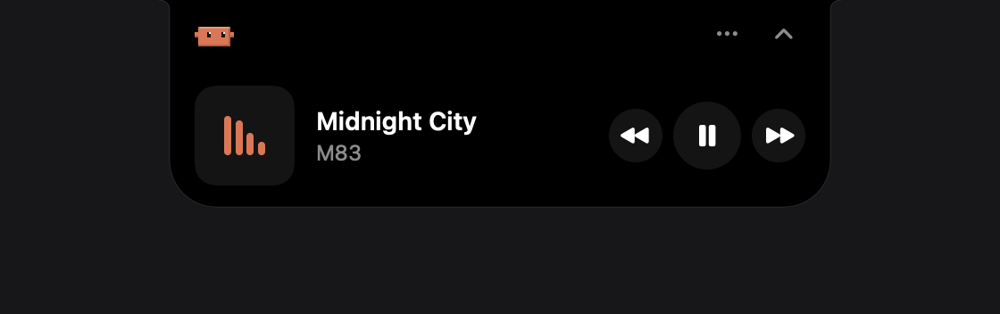

<p align="center">
  
</p>

<h1 align="center">Bitsy</h1>

<p align="center">
  A tiny pixel pet that lives on your Mac and keeps an eye on Claude Code for you.<br>
  Native Swift, menu-bar app, no web views. macOS 13+.
</p>

<p align="center">
  
</p>

Bitsy walks along your Dock, jumps between the tops of your windows, and reacts to what you're doing. It codes on a tiny laptop while Claude Code works, cheers when Claude finishes, wears headphones when music plays, and puts on a nightcap at bedtime. Drop it on the MacBook notch and it turns into a Dynamic Island.

## What it does

**Lives on your desktop**
- Walks on the Dock (or the bottom of the screen when the Dock is hidden) and jumps onto any window whose top edge you can see.
- Follows your clicks: click into a window and Bitsy heads over, hanging from its edge if there's no room on top.
- Wobbles and falls off when you drag the window it's standing on, and drops when you minimize or close it.
- Drag it anywhere. Let go and it falls with a little squash on landing.
- While you type, it sits on the window you're using and watches. When you're away, it wanders, naps and thinks.

**Claude Code companion**
- Knows when Claude Code is working: it opens its laptop and codes along, with a timer.
- When Claude finishes a task, Bitsy cheers and a speech bubble says **Done!** with the task's name. Click the bubble to jump to Claude.
- Shows your real plan usage (session and weekly %, with reset times) through Claude Code's [status line](https://code.claude.com/docs/en/statusline).
- **Double-click Bitsy** to screenshot the window it's on and paste it into your Claude chat.

**Dynamic Island**

Drag Bitsy to the notch. The notch glows as you get close and says *Drop here* when you're on it:

<p align="center"></p>

Docked, it shows live status next to the notch: Claude working, done, the current song or the time.

<p align="center"></p>

Click it and the island springs open. Click Bitsy's face for the music player, or use the tabs for Claude, Mac stats and fans.

<p align="center">
  <br>
  
</p>

<sub>Images are rendered from Bitsy's own drawing code with example data.</sub>

When an app goes full screen, Bitsy moves into the island by itself and comes back out afterwards.

**Also**
- **Coding mode:** with VS Code, Cursor, Xcode, JetBrains, Zed or a terminal in front, Bitsy codes along.
- **Music:** Spotify and Apple Music. Headphones while playing, plus previous / play-pause / next controls.
- **Sleeping hours** (default 23:00–07:00): nightcap, moon and stars. Use the Mac at night and Bitsy wakes up, lights a candle and stays up with you, yawning.
- **Mac stats:** CPU, memory, battery, uptime.
- **Fan control (Apple Silicon):** Auto, Medium, High, Max, or **Smart**, which boosts while Claude works or CPU stays above 80% and stays quiet during sleeping hours. Never below Apple's minimum speed.
- **MCP server for your agents:** `get_screen_context` (front app, windows, typing, stats) and `screenshot`, so an agent can see your screen instead of asking you to describe it.

## Install

You need macOS 13 or later and Xcode (or a Swift 5.9+ toolchain). The notch features need a MacBook with a notch; fan control has been tested on Apple Silicon.

```bash
git clone https://github.com/boyangeorgiev25/bitsy.git
cd bitsy/bitsy-mac
./build.sh
cp -R build/Bitsy.app /Applications/
open /Applications/Bitsy.app
```

Bitsy lives in the menu bar (no Dock icon) and adds itself to your login items on first launch from `/Applications`. Turn that off from its menu.

**About signing:** `build.sh` signs with your Apple Development certificate when you have one, so macOS remembers Bitsy's permissions across rebuilds. Without one it falls back to an ad-hoc signature, and you'll have to grant permissions again after every rebuild.

## Permissions

Everything works without them; each one unlocks a feature. macOS asks the first time you use it.

| Permission | Used for |
|---|---|
| Screen Recording | *Send window to Claude* (double-click) |
| Accessibility | Pasting the screenshot for you, and the Dock's exact width |
| Automation (Spotify / Music) | Play, pause, next, previous |
| Admin password (once) | Installing the optional fan helper |

After turning on Screen Recording, choose **Restart Bitsy** from its menu. macOS only applies that permission after a restart.

## Claude Code setup

**Real usage numbers.** Add Bitsy's status line bridge to `~/.claude/settings.json`:

```json
"statusLine": {
  "type": "command",
  "command": "/Applications/Bitsy.app/Contents/MacOS/bitsy-statusline",
  "padding": 0
}
```

Claude Code then passes your session and weekly limits to Bitsy after each message, and your status line reads like `Opus 5.5 · session 17% · week 21%`. Anthropic documents this data for Pro and Max plans; it also worked on a Team plan in testing. If you already have a status line, this replaces it.

**Let your agents see your screen.**

```bash
claude mcp add --scope user bitsy -- /Applications/Bitsy.app/Contents/MacOS/bitsy-mcp
```

## Fan control and its helper

Changing fan speeds needs root. Choosing **Fans → Install Fan Helper…** asks for your admin password once and installs a small helper:

- Copied to `/Library/PrivilegedHelperTools/io.bitsy.fand` (root-owned), started by `/Library/LaunchDaemons/io.bitsy.fand.plist`.
- Only accepts commands from the user who installed it. It can report status, set a speed between each fan's own minimum and maximum, or hand control back to macOS.
- Manual speeds expire after 30 seconds unless Bitsy renews them. If Bitsy quits or crashes, the fans go back to automatic.
- **Fans → Uninstall Fan Helper…** removes it.

## Privacy

Bitsy runs entirely on your Mac. It reads Claude Code's local transcripts (`~/.claude/projects`) to know when Claude is working, and the status line file above for usage. The only network request is a check of Anthropic's public status page every 5 minutes. Screenshots are only taken when you double-click Bitsy or press *Send window to Claude*, or when an agent you connected calls the MCP `screenshot` tool.

## Uninstall

1. Choose **Fans → Uninstall Fan Helper…** if you installed it, then **Quit Bitsy**.
2. Delete `/Applications/Bitsy.app`.
3. Remove the `statusLine` entry from `~/.claude/settings.json`, and run `claude mcp remove bitsy -s user`.
4. Optionally delete `~/Library/Application Support/Bitsy`.

## Project layout

```
bitsy-mac/
  Sources/Bitsy/           the app: pixel rig, animations, physics, island, popup
  Sources/BitsyKit/        shared: system stats, AppleSMC fan access, helper protocol
  Sources/bitsy-mcp/       MCP server (screen context + screenshots)
  Sources/bitsy-fand/      root fan helper
  Sources/bitsy-statusline/ Claude Code status line bridge
  icon/                    generates the app icon from the sprite
  build.sh                 builds and signs build/Bitsy.app
docs/design.html           the original character and animation sheet
```

Bitsy is drawn in code from a 32×32 pixel rig (body, four legs, two arm nubs, swappable eyes and props), so every pose is a few lines in `Anims.swift`.

---

Bitsy is an independent project and isn't affiliated with or endorsed by Anthropic. Claude and Claude Code are trademarks of Anthropic.

Released under the [MIT License](LICENSE).
